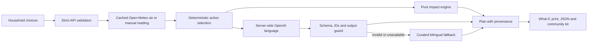

# HAWA ≋

**Breathe smarter through smog season.**

[](https://github.com/9059Rohith/hawa-air-assistant/actions/workflows/ci.yml) · [MIT](LICENSE) · English + हिन्दी · Privacy by design

**Challenge 6 — Urban Air Quality Assistant**

[Watch the narrated, captioned demo](https://drive.google.com/file/d/1rtsSNE5ervJveCU9nqPGF8UceikRsiU0/view) · [Public source](https://github.com/9059Rohith/hawa-air-assistant) · [Verification evidence](docs/QUALITY_REPORT.md)

The three-minute demo records the local production build with labelled example air data. Drive access is set to **Anyone with the link — Viewer**.

**Deployment status:** the production build works locally; Vercel rejected the new project because the owner's team is blocked under its fair-use policy. A production URL is not yet available. See [verified results and remaining limits](docs/QUALITY_REPORT.md). A ranking or competition score is not claimed.

## Problem and our approach

A family facing winter smog needs more than an alarming AQI number. It needs practical choices that fit its home, budget and journey. HAWA turns air data and household preferences into a daily plan, then shows what changes under explicit assumptions. The AI writes explanations; small, tested functions calculate impacts. Community organisers can turn the same guidance into a printable seven-day kit.

## What it does

- Search a city, opt into approximate geolocation, or enter a PM2.5 sensor reading. Live data carries its source, timestamp and stale-data warning.
- Configure a five-step household profile, or start with Meera, Ramesh or Ananya. Demo air is clearly identified as illustrative.
- Generate a plan with up to ten curated actions for indoor air, daily routines, transport, cooking, heating and community participation.
- Toggle actions in a what-if comparison. Combined exposure effects are recomputed rather than adding percentages.
- Inspect every calculation, input and source. Quantitative results are labelled low-confidence scenarios; unsupported cooking/waste numbers are deliberately absent.
- Ask follow-up questions, with validated AI language or rules fallback, knowledge citations and urgent-symptom escalation.
- Print, download JSON, share a non-sensitive action summary, size a purifier, browse 60 bilingual guidance entries and create a community notice.
- Choose Hindi, simple wording, light/dark/high-contrast themes and browser read-aloud. Some engineering explanations and secondary controls remain English.

## Why it is different

**The calculator owns the numbers.** Model output cannot change action IDs, add links or supply numeric claims. A failed provider request, malformed output or missing key produces a useful rules-based plan. Source provenance, modelling boundaries and limitations are visible beside the result.

**Safety comes before carbon savings.** HAWA does not recommend extra outdoor exercise during severe smog just because walking has low operational emissions. Indoor coal burning receives priority because a particle filter does not remove carbon monoxide.

## Judging parameters map

| Parameter     | Concrete proofs                                                                                                     | Where to verify                                                                             |
| ------------- | ------------------------------------------------------------------------------------------------------------------- | ------------------------------------------------------------------------------------------- |
| Code quality  | Strict TypeScript and unchecked-index checks; Zod contracts; pure domain/service/UI separation                      | `tsconfig.json`, `src/domain`, `npm run typecheck`                                          |
| Security      | Server-only credentials; allowlisted HTTPS and no redirects; 8 KB strict bodies, rate/concurrency limits, nonce CSP | `src/services/{http,transport,llm}.ts`, `src/middleware.ts`, `npm run scan-secrets`         |
| Efficiency    | Fifteen-minute air cache with bounded stale fallback; bounded plan cache; deferred chat and validation code         | `src/services/cache.ts`, `src/services/plan.ts`, `reports/bundle.json`                      |
| Testing       | Boundary/invariant tests; hostile-output and API-failure tests; desktop/mobile browser journeys                     | `tests/domain.test.ts`, `tests/services.test.ts`, `tests/e2e`                               |
| Accessibility | Semantic native controls and visible focus; three contrast-tested themes; axe checks across all five pages          | `scripts/check-contrast.mjs`, `reports/browser-accessibility.json`, `docs/ACCESSIBILITY.md` |
| Alignment     | Household routines with impact comparisons; indoor/cooking guidance; community action kit                           | `src/components/PlanView.tsx`, `src/data/knowledge.ts`, `src/components/Community.tsx`      |

## Problem statement traceability

| Requirement                      | Working feature                                                                 | Evidence                                                   |
| -------------------------------- | ------------------------------------------------------------------------------- | ---------------------------------------------------------- |
| GenAI-powered assistant          | OpenAI plan explanations and grounded follow-ups; deterministic fallback        | `reports/live-ai.json`, `tests/services.test.ts`           |
| Families and communities         | Household wizard, personas, school/RWA/neighbourhood kit                        | `tests/components.test.tsx`                                |
| Winter smog and urban pollution  | Modelled air, current EPA breakpoints, independent CPCB PM2.5 bands             | `tests/domain.test.ts`                                     |
| Low-emission daily routines      | Feasible commute alternatives, safe exercise and timing guidance                | `src/domain/select.ts`                                     |
| Indoor air quality hacks         | Filter sizing, source control, room checklist, myths                            | `src/components/Learn.tsx`                                 |
| Location and lifestyle tailoring | City/coordinate selection, risk flags, home, travel, budget and language        | `tests/e2e/smoke.spec.ts`                                  |
| Direct impact                    | Transparent combined scenario, sources, individual/weekly/community comparisons | `src/domain/impact.ts`, [methodology](docs/METHODOLOGY.md) |

## Quick start

Node 22 or 24 is required.

```sh
npm ci
cp .env.example .env.local
npm run dev
```

Open `http://localhost:3100`. Without a key, the full rules-based path works. For AI, set `LLM_API_KEY` only in the ignored `.env.local` or the hosting platform's encrypted environment. `LLM_MODEL` defaults to `gpt-4o-mini`; `ENABLE_LLM=false` disables provider calls. Never put credentials in `NEXT_PUBLIC_` variables. Rotate any key shared in a conversation before production use.

```sh
npm run lint
npm run typecheck
npm run test:coverage
npm run build
npm run test:e2e
```

Browser tests default to installed Microsoft Edge on Windows. On other systems, install Playwright Chromium and run with `BROWSER_CHANNEL=chromium`. CI does this automatically. `npm run start` serves the built app on port 3100. `npm run doctor` prints configuration status without secret values.

## Architecture and data flow



See [architecture](docs/ARCHITECTURE.md) and the [decision records](docs/adr).

## Impact methodology

Exposure is an **ambient-only illustrative scenario**, not a wearable measurement or medical prediction. Outdoor time, building infiltration, room volume, CADR and adult respirator penetration shape a single combined calculation. Transport emissions use explicitly rounded scenario factors; they are not represented as validated Indian inventory factors. Weekly and community projections assume repeat participation. See [formulas, worked example, boundaries and uncertainty](docs/METHODOLOGY.md).

## Security and accessibility

No analytics, accounts, advertising or application cookies. Coordinates are rounded before upstream requests; the model receives a compact household description, not coordinates. Profiles are saved locally only when requested and can be cleared. Health-risk flags in saved profiles remain sensitive on shared devices. [Threat model](SECURITY.md).

HAWA targets WCAG 2.2 AA. Automated axe checks and contrast checks are evidence, not a certification. Independent screen-reader and full translation reviews remain outstanding. [Accessibility test matrix](docs/ACCESSIBILITY.md).

## Performance and verification

Every reported result comes from a command or browser run. [Quality report](docs/QUALITY_REPORT.md), [bundle measurement](reports/bundle.json), [coverage](reports/coverage.json), [15 browser accessibility states](reports/browser-accessibility.json). Local performance is not a production latency promise.

## Project structure and scripts

| Path / command                    | Purpose                                                       |
| --------------------------------- | ------------------------------------------------------------- |
| `src/domain`                      | Pure AQI, safety, action selection and impact functions       |
| `src/services`                    | Upstream fetching, bounded cache, guarded AI, HTTP validation |
| `src/app/api`                     | Same-origin API transport                                     |
| `src/components`                  | Household and community workflows                             |
| `src/data`, `src/i18n`            | Curated knowledge, source registry, personas and language     |
| `npm run check-bundle`            | Actual rendered modern-browser home scripts, gzip size        |
| `npm run check-repo-size`         | Eight-MB source guard, stricter than submission limit         |
| `npm run scan-secrets`            | Credential-pattern scan without printing values               |
| `node scripts/check-contrast.mjs` | Text/surface contrast across themes                           |

Stack: Next.js 15.5.29 App Router, React 19, strict TypeScript, Zod, Tailwind/CSS, Vitest, Testing Library, axe-core and Playwright. React 19 follows the installed supported Next.js stack rather than pinning the older React 18 requested in the initial brief.

## Deploy in five minutes

1. Resolve the owner's Vercel team restriction, then import this public repository; choose Next.js and Node 22.
2. Add `LLM_API_KEY` as an encrypted Production variable, set `LLM_MODEL`, and set `APP_ORIGIN` to the assigned origin.
3. Deploy. No database or paid storage service is required.
4. Check `/api/health`, generate a real AI plan, then check the rules-mode toggle and citation chat.
5. Record production measurements and place the verified URL here. Current owner's Vercel restriction must be resolved before this step succeeds.

The multi-stage non-root Dockerfile is an alternative packaging route. Docker execution has not been verified in this environment.

## Roadmap and known limits

Distributed rate limits, independent emissions-factor validation for Indian modes/fuels, full Hindi interface review, assistive-technology testing, school curriculum kits and optional community integrations. Rules mode works without an AI key but still requires access to the application server. Already displayed guidance remains readable after connectivity loss; HAWA does not currently provide an installable service-worker offline shell.

## Disclaimer, attribution and license

General protective guidance only. For urgent breathing symptoms, seek medical care. Do not alter medication based on HAWA. Modelled air can differ from monitors. No score, rank or health benefit is guaranteed.

Air data: [Open-Meteo](https://open-meteo.com/en/docs/air-quality-api), CAMS/ECMWF, CC BY 4.0. [Source registry](src/data/sources.ts). Source code: [MIT](LICENSE).
